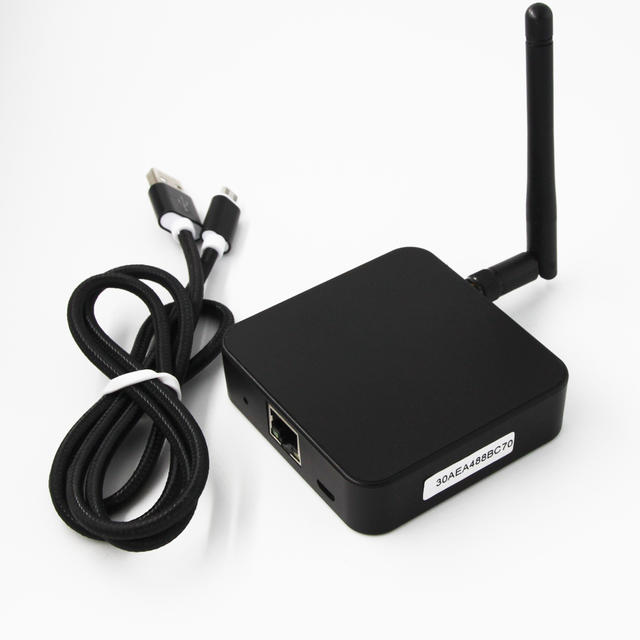

# ESPHome for the April Brother AB BLE Gateway V4

The AB BLE Gateway V4 is an ESP32- and nRF52832-based BLE-to-network gateway, widely sold through AliExpress, Amazon and Taobao. Its stock firmware forwards BLE advertisements (iBeacon, Eddystone or custom data) to a server over MQTT, HTTP or WebSockets; see the [April Brother wiki](https://wiki.aprbrother.com/en/AB_BLE_Gateway_V4.html).

This firmware turns it into a local Home Assistant Bluetooth gateway: the ESP32 becomes a connectable ESPHome Bluetooth proxy, and the nRF52832 a second, listen-only scanner through a custom HA integration. Installation goes over the network from stock, imports the stock Wi-Fi settings and keeps stock as a fallback.

## Device

| Part | Specification |
| --- | --- |
| Main processor | Classic ESP32, 4 MiB flash |
| Second radio | nRF52832 running April Brother's stock scanner firmware (left intact) |
| Radio link | UART: ESP32 RX=GPIO32, TX=GPIO33; 115200 baud, 8N1 |
| Ethernet | LAN8720-family PHY, address 1, MDC GPIO23, MDIO GPIO18, RMII clock out GPIO17, PHY reset GPIO13 |
| Configuration button | GPIO12, active low |
| Status LED | GPIO5, active low, per published drawings |

Check your PCB revision against the [hardware drawings](https://github.com/AprilBrother/ab-hardware/tree/master/ab-ble-gateway-v4).

## Features

Configuration: `ab-ble-gateway-v4.yaml`.

| Feature | Behavior |
| --- | --- |
| Wi-Fi | Imports stock personal Wi-Fi; Improv provisioning over UART0 |
| Network select | **Automatic**: Ethernet only without saved Wi-Fi; **Wi-Fi** or **Ethernet**: explicit selection; changes restart the gateway |
| ESP32 Bluetooth proxy | Passive scanning; active GATT, one connection slot |
| nRF52832 UART | `serial_proxy` port `Nordic scanner`; HA starts and decodes scanning |
| Native API and OTA | Encrypted, per-device key; OTA TCP 3232 |
| Software buttons | **Accept firmware**, **Restore stock firmware**, **Restart** |
| Physical button | Binary sensor; 10-second hold resets ESPHome settings after acceptance |
| LED | Status indication |
| Diagnostics | Uptime, Wi-Fi signal and network, IP address, ESPHome version |
| Web UI | None: it does not fit in the stock 1 MiB OTA slot. Use Home Assistant. |

Wi-Fi and Ethernet share one image but run one at a time, as on stock: Wi-Fi is unstable while the ESP32 generates the Ethernet RMII clock.

## Guides

- [Build firmware](docs/building.md)
- [Migrate from stock and restore it](docs/migrating-from-stock.md)
- [Set up Home Assistant](docs/home-assistant.md)
- [nRF52832 UART protocol](docs/uart-protocol.md)

## Hardware validation

- **Tested:** migration from stock 1.5.13, Wi-Fi import, encrypted API/OTA, ESP32 proxy and GATT, timed return and restore button, nRF52832 scanner in HA.
- **Not yet tested:** Ethernet and the Network select, button, LED, Improv, HA starting the nRF52832 scan, other stock versions and PCB revisions, power loss during the factory copy.

## Vendor references

[Quick start](https://wiki.aprbrother.com/en/Quick_Start_For_AB_BLE_Gateway_V4.html) · [FAQ](https://wiki.aprbrother.com/en/FAQ_For_AB_BLE_Gateway_V4.html) · [Software](https://wiki.aprbrother.com/en/Software_AB_BLE_Gateway_V4.html)

## License

Apache License 2.0, see [LICENSE](LICENSE).
